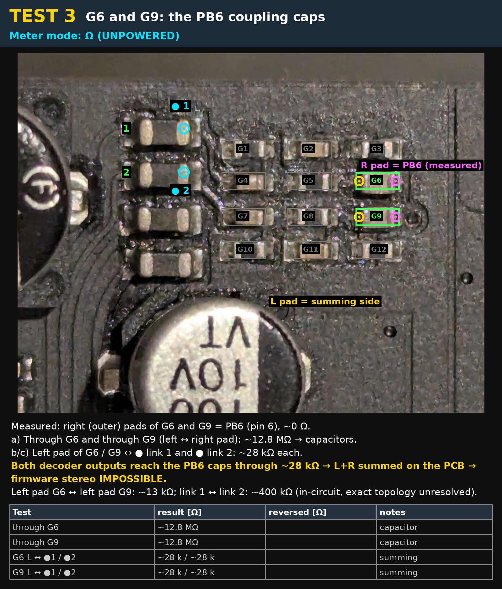
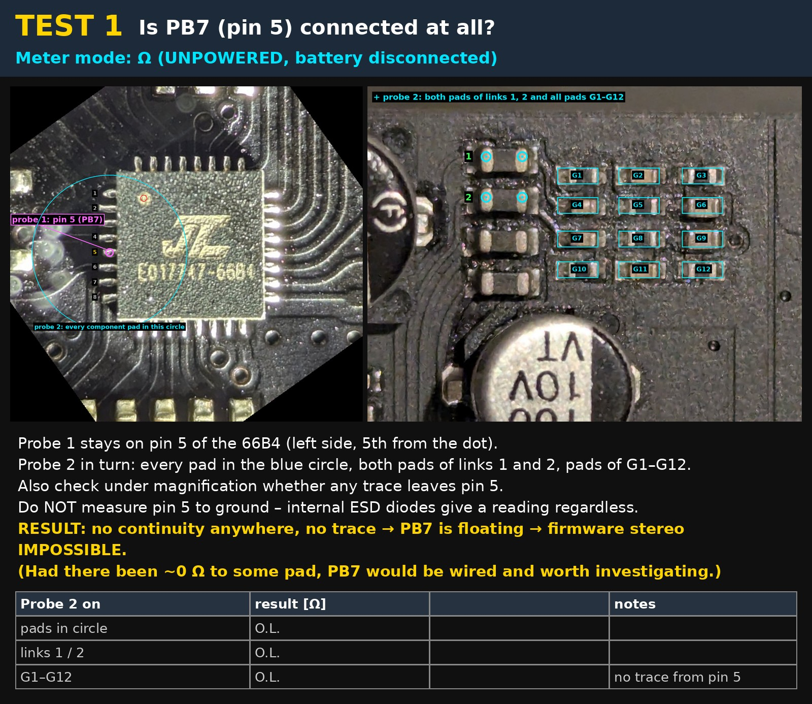
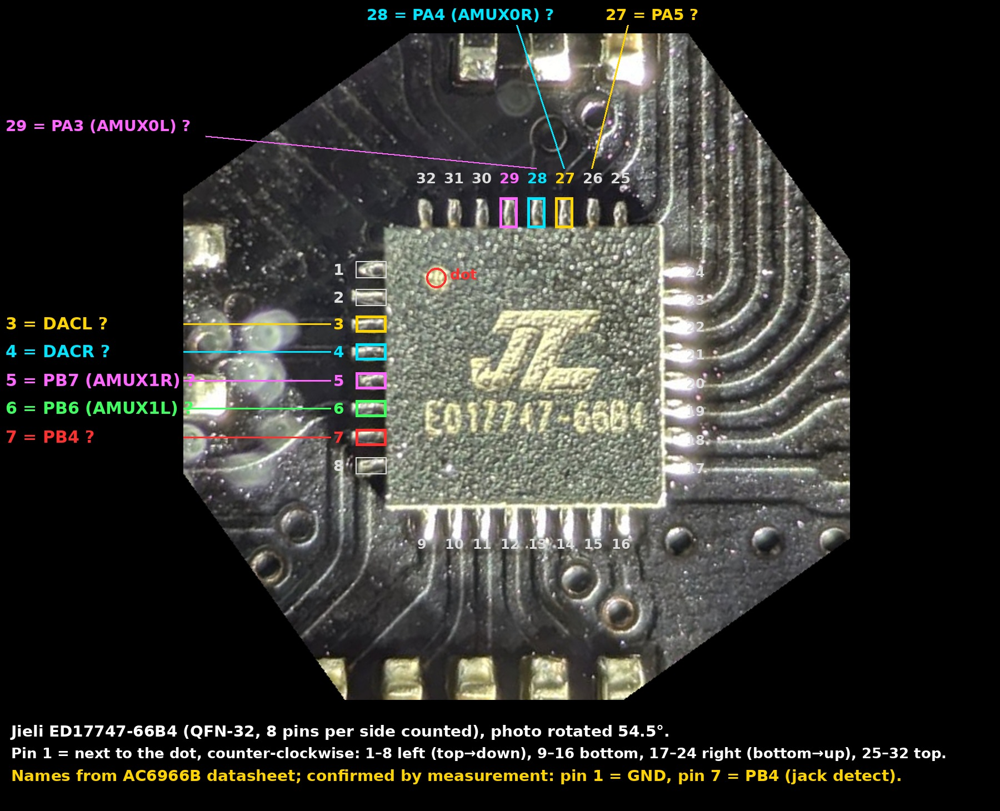
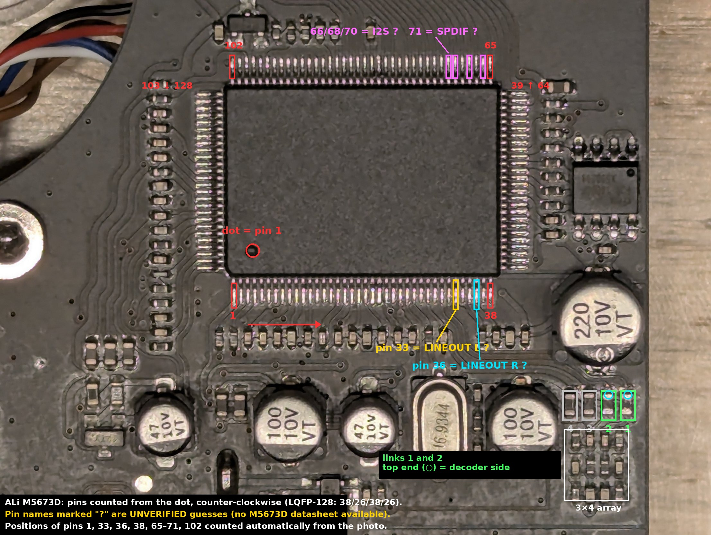
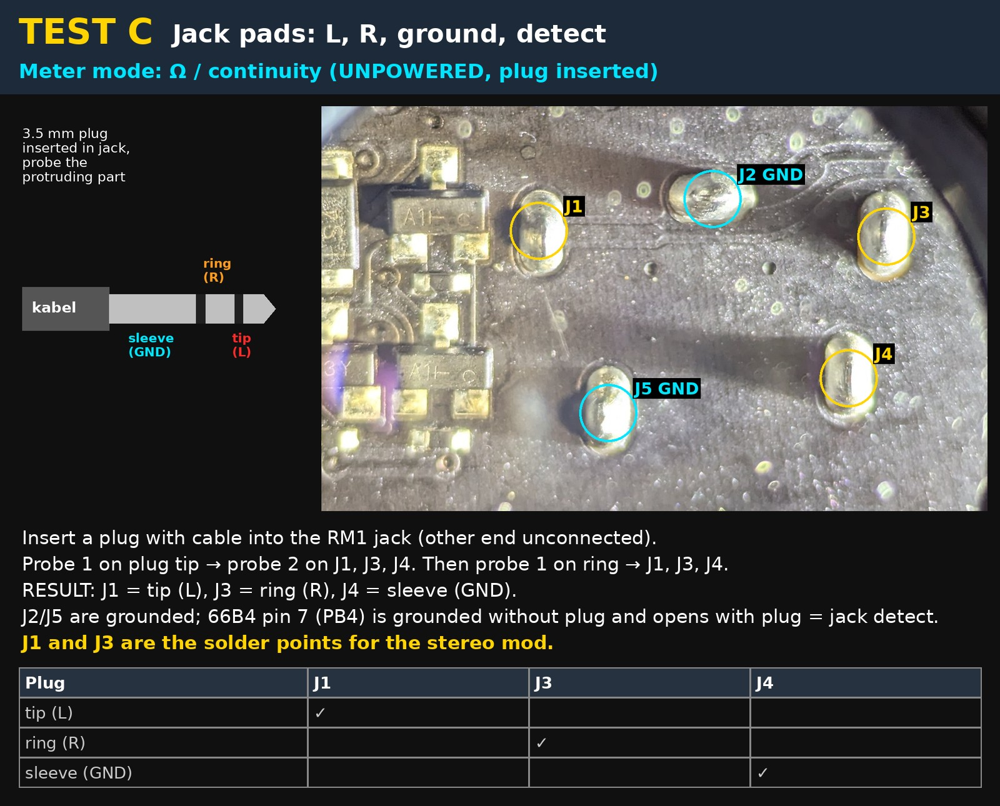
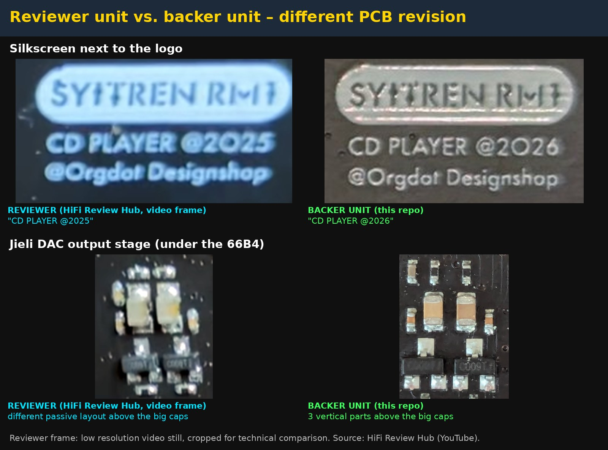
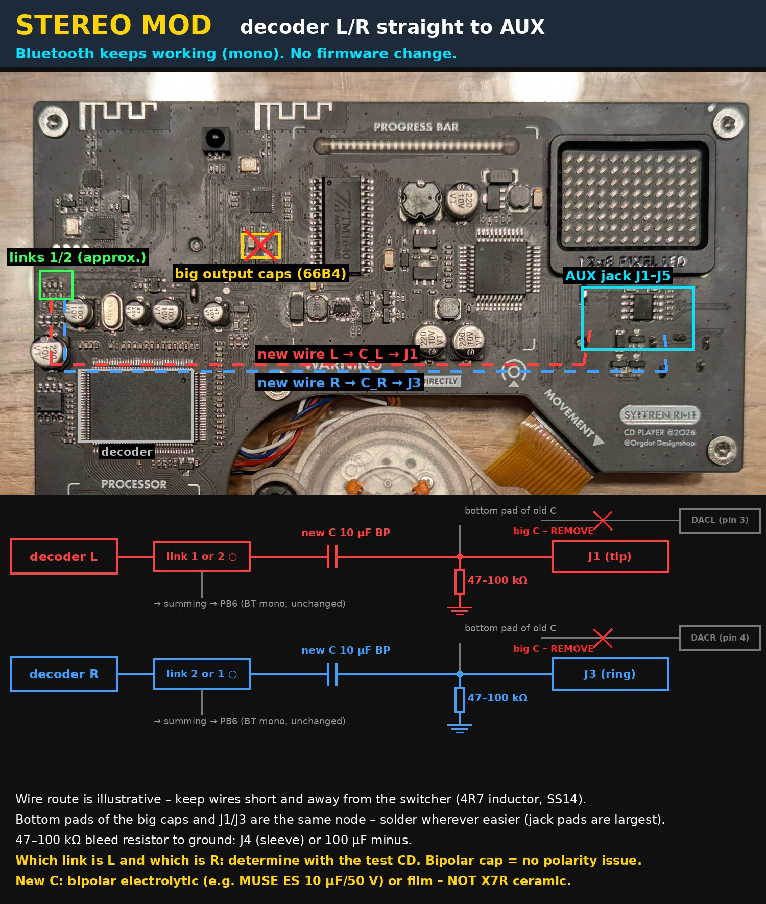
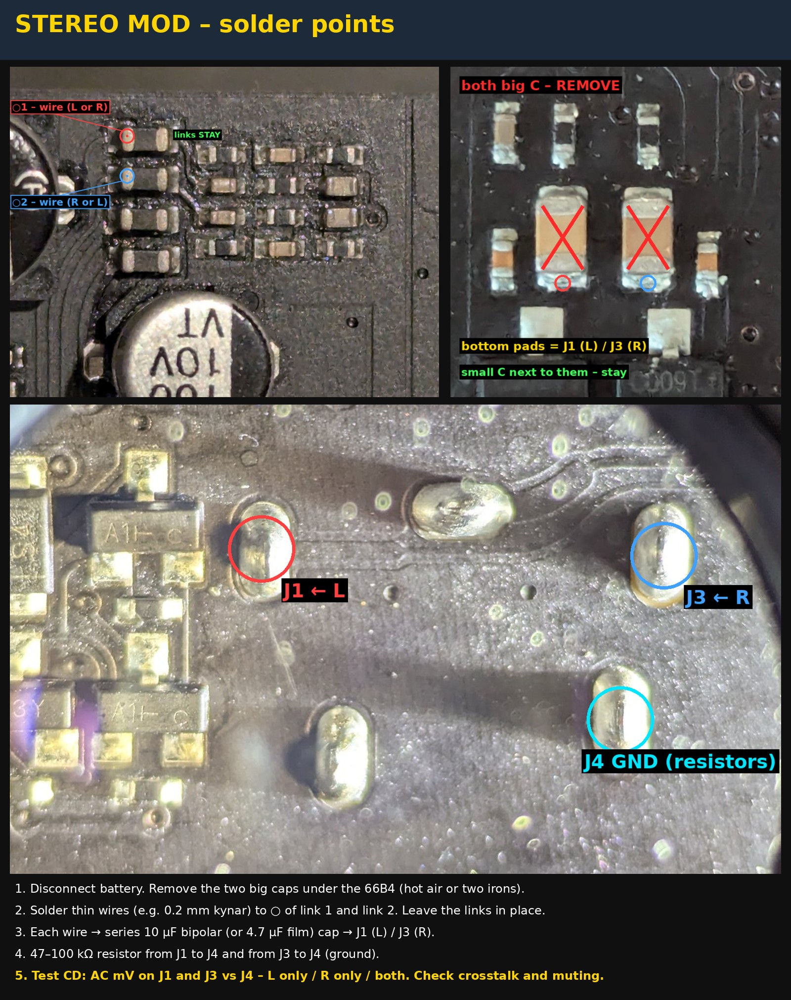

# SYITREN RM1 – why it plays mono, and a hardware stereo mod

Community teardown of the **SYITREN RM1** Kickstarter CD player (firmware `AC696N_V160-@20220526-$dacf791`).
The unit outputs **identical L+R mono on both channels** of the 3.5 mm AUX jack (verified: both channels of an AUX recording of a stereo CD are sample-identical).

This repo documents **why** (firmware + board measurements) and a **proposed hardware mod** that brings real stereo to the AUX jack.

> ⚠️ **Status: the mod is NOT yet built or tested.** One precondition – that the CD decoder actually outputs separate L/R – is still unmeasured (see [Open items](#open-items)). Do it at your own risk; it voids any warranty.
>

---

## TL;DR

| Question | Answer | Confidence |
|---|---|---|
| Can stereo be enabled by a firmware update? | **No.** L and R are summed on the PCB before the only audio input the Bluetooth chip reads. The second input pin (PB7) is not connected at all. | High (code + measurement) |
| Can stereo over Bluetooth ever work on this board? | **No.** The BT chip (Jieli AC6966B-class) has a single ADC channel and reads one pin. | High |
| Is the reviewer's stereo unit the same hardware? | **No.** Its PCB is marked @2025, backer units @2026, with a different output stage layout. | High |
| Can AUX be made stereo? | **Probably yes**, with 2 capacitors + 2 resistors + 2 wires, *if* the decoder outputs separate L/R. BT keeps working (mono). | Medium (pending test) |

---

## Signal path (as found)

```
CD decoder (ALi M5673D, analog L/R out)
   │L          │R
 link 1      link 2            (0 Ω jumpers next to a 3×4 passive array)
   │           │
   ├── ~28 kΩ ─┴── ~28 kΩ ──►  passive network ──► 2 caps ──► PB6 (pin 6)
   │                                                                  │
   │                                     Jieli 66B4: single ADC on PB6 (LIN1L)
   │                                                                  │
   │                                     DAC configured STEREO (DACL/DACR)
   │                                     but both carry the same mono signal
   │                                                                  │
   │                                     pin 3 DACL ─ big MLCC ─► J1 (tip, L)
   │                                     pin 4 DACR ─ big MLCC ─► J3 (ring, R)
   └─────────────────────────────────────────────────────────► (BT A2DP: mono)
```

## Firmware findings

Flash dumped read-only over USB-C (bootloader mode, `kagaimiq/jl-uboot-tool`, two identical reads), unpacked with `kagaimiq/jl-misctools`, disassembled (pi32v2) and matched against a build of the public **AC696N soundbox SDK** (`sdk.elf` with symbols).

- **Line-in path:** exactly one path; `audio_adc_linein_open` called once. Source field set to `|= 8` → `AUDIO_LIN1L_CH` = **PB6 only**, `ch_num = 1`. (SDK BT-emitter template uses LIN0L/PA3.)
- **DAC:** `dac_platform_data` word `0x00878352` → `output = DAC_OUTPUT_LR` (**stereo**). Mono is created *before* the DAC.
- **No digital input:** BR25 has no SPDIF block; SPDIF/FM/RECORD app modes not compiled in; ALNK (I²S) registers never referenced.
- **PB7 (second AMUX input):** never configured. **PA3/PA4:** used as digital GPIO (PA4 toggled output).
- **Custom `earphone` device** (not in SDK): polls **PB4** every 50 ms with pull-up → jack-insert detection (confirmed by measurement).
- Re-encryption round-trip of the app area (chip-key 13462) reproduces the dump byte-for-byte, CRCs verified – but patching firmware is pointless given the hardware summing.

## Board measurements (unpowered, Ω mode)

Jieli chip marked **ED17747-66B4** (QFN-32, near the IR receiver) – pinout matches AC6966B datasheet (confirmed by pin 1 = GND and pin 7 = PB4 jack-detect).

| Measurement | Result | Meaning |
|---|---|---|
| Pin 5 (PB7) ↔ anything nearby | no continuity, no trace | **PB7 floating** |
| Pin 6 (PB6) ↔ outer pads of 2 parts in last column of the 3×4 array | ~0 Ω | PB6 node |
| Through those 2 parts | ~12.8 MΩ | coupling capacitors |
| Inner pads ↔ link 1 and link 2 | ~28 kΩ each | **resistive summing of L+R** |
| Inner pad ↔ inner pad of the two caps | ~13 kΩ | not one node – exact topology unresolved (in-circuit readings) |
| Link 1 ↔ link 2 (Jieli side) | ~400 kΩ | not shorted; DC only, says nothing about AC crosstalk |
| Pin 1 ↔ outer pads of 1st/4th part in that column ↔ 100 µF minus | continuity | GND, filter caps |
| Pin 7 ↔ jack ground pads | continuity without plug, open with plug | PB4 jack-detect switch |
| Jack: J1 / J3 / J4 | tip (L) / ring (R) / sleeve | |
| J1 ↔ bottom pad of left big MLCC under 66B4; J3 ↔ right one | continuity | DAC output coupling caps |







## The reviewer's unit is a different PCB revision

The unit shown by **HiFi Review Hub** on YouTube reportedly plays stereo (AUX and Bluetooth). SYITREN said it was the same hardware as the backer units. The photos say otherwise:

- **Silkscreen:** reviewer board reads **"CD PLAYER @2025"**, backer board reads **"CD PLAYER @2026"**. Silkscreen only changes with a new PCB revision. *(high confidence)*
- **DAC output stage under the Jieli 66B4:** passive parts above the two big output caps are laid out differently. *(medium confidence – low-res video frame)*



What this does and does not show:
- On the backer board, stereo on AUX or BT is impossible regardless of firmware (see above). So **if** the reviewer unit plays stereo, its audio path must be wired differently – consistent with a different PCB revision.
- The visible difference is in the **output** stage; the frame is too low-res to see whether the **input** summing network or the PB7 trace differ.
- It is still possible the reviewer was mistaken about stereo. A recording of test-CD tracks 1 and 2 from that unit would settle it.

## The mod (AUX stereo, BT stays mono)

Take L/R straight from the decoder side of the two links and feed the jack, disconnecting the Jieli DAC outputs.




**Parts:** 2 × 10 µF **bipolar** electrolytic (e.g. Nichicon MUSE ES 10 µF/50 V) or 4.7 µF film (MKT/MKS); 2 × 47–100 kΩ resistor; thin wire (e.g. 0.2 mm kynar). *Do not use X7R/X5R ceramics.*

**Per channel:**
```
link pad (decoder side) ──wire── [10 µF BP] ──┬── J1 (L)   /   J3 (R)
                                               │
                                          [100 kΩ]
                                               │
                                           J4 (ground)
```
1. Disconnect battery. Remove the **two big MLCCs** under the 66B4 chip (cuts Jieli DAC from the jack).
2. Solder a wire to the **decoder-side pad** of link 1 and link 2. Leave the links in place → summing network still feeds PB6 → **Bluetooth keeps working (mono)**.
3. Each wire → series capacitor → J1 / J3.
4. 100 kΩ from J1 to J4 and from J3 to J4 (bleed resistors; the small parts next to the MLCCs are capacitors, not resistors).
5. Verify with the test CD (AC mV on J1/J3 vs J4).

The existing SOT-23 mute transistors stay; check after the mod that they don't mute during playback.

## Test CD

`tools/make_test_cd.py` generates a BIN/CUE + WAVs: L-only, R-only, both (400 Hz – multimeter-friendly), L400/R1k, L/R 1 kHz, silence. Burn as Audio CD on CD-R.

Measure AC mV vs. the 100 µF minus (ground):
- **Before the mod**, on the decoder-side pads of link 1 / link 2: track 1 should show signal on one link only, track 2 on the other. **If both links show the same level on tracks 1 and 2, the decoder itself outputs mono and the mod is pointless.**
- **After the mod**, on J1 / J3: same test, also gives you the crosstalk figure.

## Open items

- [ ] Decoder L/R separation on links 1/2 (test CD, AC mV) – **go/no-go for the mod**
- [ ] Which link is L and which is R
- [ ] Crosstalk with links left in place (depends on decoder output impedance)
- [ ] Build + listening test
- [ ] Whether the 2025 reviewer board also differs on the **input** side (no summing network / PB7 wired) – needs a clear photo of that area or a test-CD recording from that unit

## Tools / references

- [kagaimiq/jl-uboot-tool](https://github.com/kagaimiq/jl-uboot-tool), [kagaimiq/jl-misctools](https://github.com/kagaimiq/jl-misctools)
- [jvitkauskas/pi32v2-isa](https://github.com/jvitkauskas/pi32v2-isa)
- AC696N soundbox SDK (public mirrors on GitHub), AC6966B datasheet (LCSC/szlcsc)

No firmware binaries are distributed here.

## License

Text and images: CC BY 4.0. Script: MIT.
